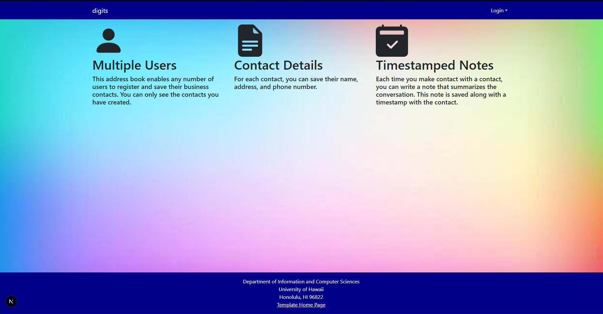
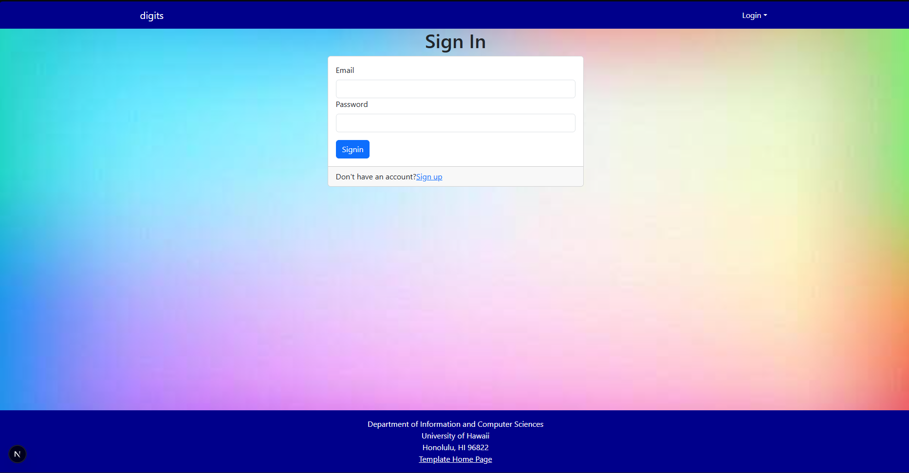
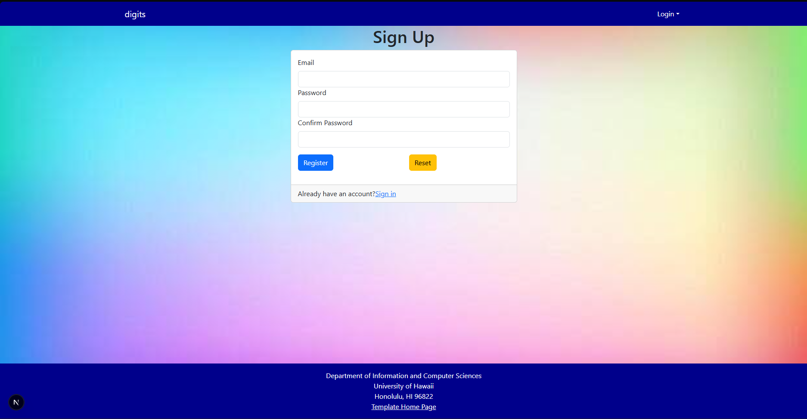
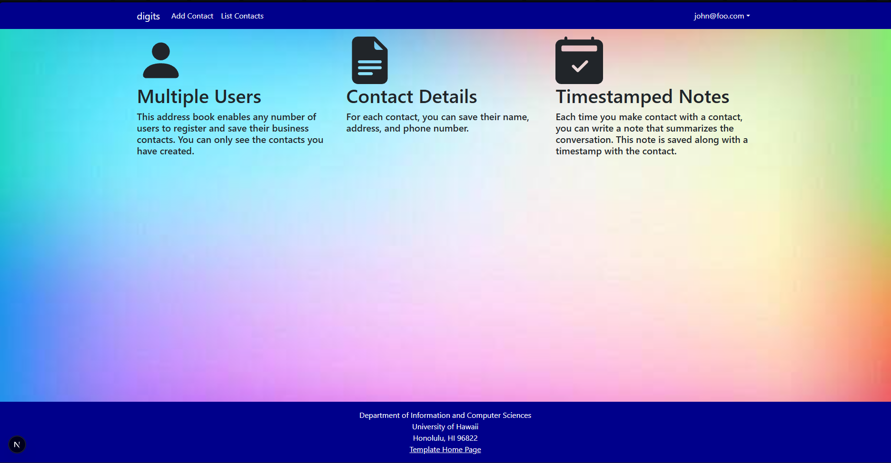
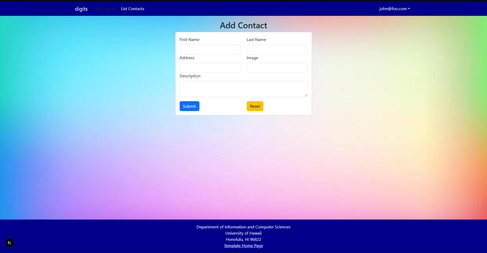
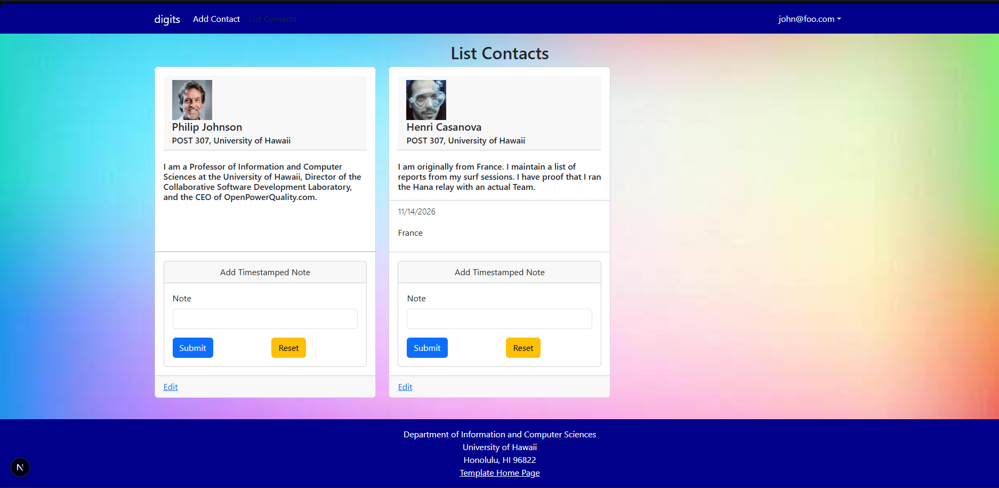
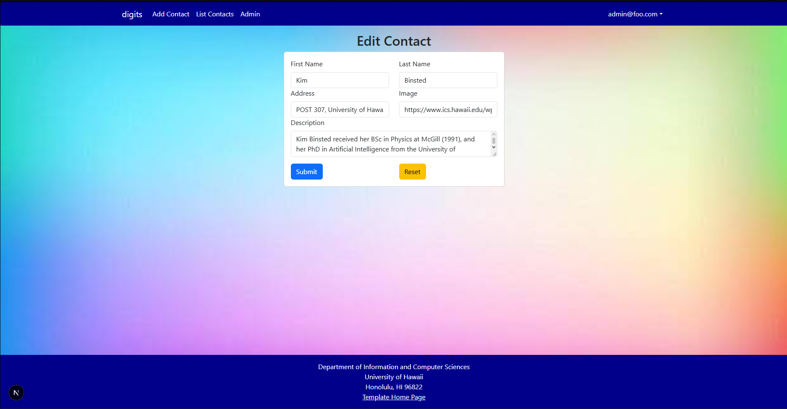
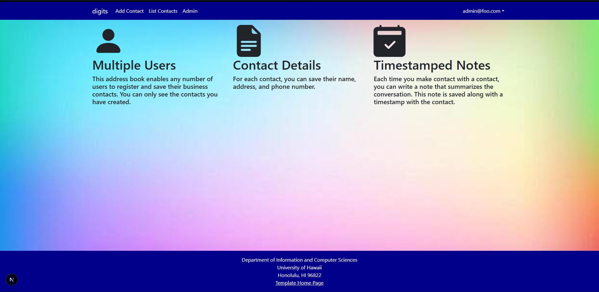
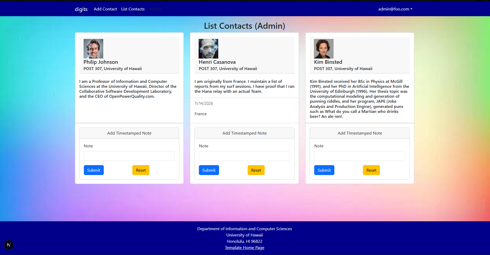

## Installation

1. Install [PostgreSQL](https://www.postgresql.org/download/) and create a database:

   ```
   createdb <app-name>
   ```

2. Clone this repo and install dependencies:

   ```
   git clone https://github.com/<user>/<repo>.git
   cd <repo>
   npm install
   ```

3. Copy `sample.env` to `.env` and edit `DATABASE_URL` to match your database name, user, and password:

   ```
   DATABASE_URL="postgresql://<user>:<password>@localhost:5432/<app-name>?schema=public"
   ```

4. Create the tables and generate the Prisma client:

   ```
   npx prisma migrate dev
   npx prisma generate
   ```

5. Seed the database from `config/settings.development.json`:

   ```
   npm run seed
   ```

6. Run the app and open http://localhost:3000:

   ```
   npm run dev
   ```

Log in with a default account from `config/settings.development.json` (e.g. `john@foo.com` as a user, `admin@foo.com` as an admin), or register a new one.

## Walkthrough

### Landing page


The home page. Use the login menu in the navbar to sign in or register.

### Sign In page


Log in with an existing email and password.

### Register page


Create a new account.

### Landing page (logged in)


After login, the navbar adds the Add Contacts and List Contacts to the navbar.

### Add Contact page


A form to add a contact with first name, last name, address, an image, and description.

### List Contacts page


Shows the contacts created. Click "Edit" on a row to change it.

### Edit page


Change and save contact information.

### Admin landing page


Admin users get an extra "Admin" link in the navbar.

### Admin page


Lists every contact. Non-admins are redirected to the Not Authorized page, even if they type the URL.
